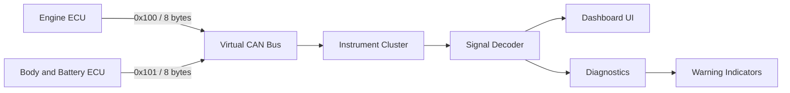

# System Architecture

## Logical components

1. **Engine ECU** creates a CAN-style frame with speed, RPM, temperature and gear.
2. **Body/Battery ECU** creates a CAN-style frame with fuel, battery voltage, seatbelt and door state.
3. **Virtual CAN Bus** transports frames through an in-process queue.
4. **Instrument Cluster** decodes frames by arbitration ID and updates the dashboard.
5. **Diagnostics** evaluates decoded values against demonstration thresholds.

## Data flow

## Limitations
The bus is a software queue and not a physical CAN network. This project does not claim
AUTOSAR compliance, OEM calibration, automotive safety certification or real vehicle testing.
